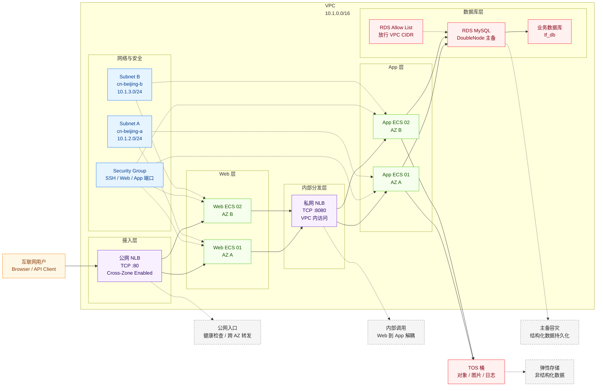

# 高可用、安全可扩展的 Web 应用部署

在火山引擎上部署一套高可用、可扩展的三层 Web 应用基础设施，覆盖网络、计算、负载均衡、数据库和对象存储等核心资源。该方案采用经典三层架构，部署于同一 VPC 内的多可用区子网中，并通过统一安全组管控东西向与南北向流量。

## 1. 业务背景

企业 Web 应用在生产环境落地时，通常会遇到以下问题：

- **部署链路长**：VPC、子网、安全组、ECS、负载均衡、数据库、对象存储等资源需要跨多个控制台手工配置，容易遗漏步骤。
- **环境一致性差**：测试、预发、生产环境如果依赖人工搭建，参数和拓扑容易不一致，后续排障成本高。
- **高可用要求高**：公网入口、应用服务器和数据库都需要具备跨可用区容灾能力，避免单点故障影响业务访问。
- **安全边界复杂**：互联网入口、Web 层、App 层和数据层访问路径不同，需要通过安全组、私网负载均衡和 RDS 白名单进行隔离。
- **扩展和回收成本高**：业务高峰期需要快速扩容，验证结束后也需要可靠销毁资源，降低闲置成本。

本方案通过 Terraform 将上述基础设施标准化、模块化，帮助用户快速完成三层 Web 应用的基础环境交付。

## 2. 方案概述

整体采用经典三层架构：

- **接入层**：公网 NLB 承接互联网流量，并转发到 Web 层 ECS。
- **Web 层**：多台 Web ECS 跨可用区部署，处理前端访问请求。
- **内部分发层**：私网 NLB 在 VPC 内部将 Web 层请求分发到 App 层。
- **App 层**：多台 App ECS 跨可用区部署，处理核心业务逻辑。
- **数据层**：RDS MySQL 主备实例承载结构化数据，TOS 桶存储非结构化数据。
- **安全控制**：统一安全组控制 ECS 入站访问，RDS 白名单默认放行 VPC 网段。



## 3. IaC 设计

### 3.1 资源清单

当前 `terraform.tfvars` 开启全部模块时会创建 18 项资源。资源数量会随子网、ECS 数量和功能开关变化：

| Terraform 资源 | 用途 |
| --- | --- |
| `volcenginecc_vpc_vpc` | 创建业务 VPC，提供隔离的网络空间 |
| `volcenginecc_vpc_subnet` × `length(subnet_cidrs)`，当前为 2 | 创建跨可用区子网，承载 ECS、NLB 和 RDS |
| `volcenginecc_vpc_security_group` | 创建统一安全组，控制 SSH、Web 和 App 端口访问 |
| `volcenginecc_ecs_instance`（Web）× `web_instance_count`，当前为 2 | 启用计算模块时创建 Web 层 ECS，接收公网 NLB 转发的流量 |
| `volcenginecc_ecs_instance`（App）× `app_instance_count`，当前为 2 | 启用计算模块时创建 App 层 ECS，处理业务逻辑并访问数据层 |
| `volcenginecc_clb_nlb`（internet） | 同时启用计算和负载均衡模块时创建公网 NLB |
| `volcenginecc_clb_nlb_server_group`（web） | 创建 Web 后端服务器组，绑定 Web ECS |
| `volcenginecc_clb_nlb_listener`（internet） | 创建公网 NLB 监听器，当前监听 TCP 80 |
| `volcenginecc_clb_nlb`（intranet） | 同时启用计算和负载均衡模块时创建私网 NLB |
| `volcenginecc_clb_nlb_server_group`（app） | 创建 App 后端服务器组，绑定 App ECS |
| `volcenginecc_clb_nlb_listener`（intranet） | 创建私网 NLB 监听器，当前监听 TCP 8080 |
| `volcenginecc_rdsmysql_instance` | 启用 RDS 模块时创建双节点 RDS MySQL 实例 |
| `volcenginecc_rdsmysql_allow_list` | 启用 RDS 模块时创建白名单，默认放行 VPC 网段 |
| `volcenginecc_rdsmysql_database` | 启用 RDS 模块时创建业务数据库并授权高权限账号读写 |
| `volcenginecc_tos_bucket` | 启用 TOS 模块时创建对象存储桶，用于非结构化数据 |

说明：

- Web 和 App ECS 数量由 `web_instance_count`、`app_instance_count` 控制，默认各 2 台。
- 子网数量由 `availability_zones` 和 `subnet_cidrs` 控制，默认 2 个可用区。
- RDS 白名单在 `allow_list_cidrs` 非空时创建；根模块默认会放行当前 VPC CIDR。

### 3.2 工程结构

工程采用模块化设计，根模块负责编排，各子模块封装具体资源：

```text
.
├── main.tf                         # 根模块编排，按依赖关系调用各子模块
├── variables.tf                    # 全局变量定义，包括地域、规格、开关和密码变量
├── outputs.tf                      # 输出关键资源 ID、地址和名称
├── providers.tf                    # volcenginecc Provider 配置
├── versions.tf                     # Terraform 与 Provider 版本约束
├── locals.tf                       # 通用标签和 TOS 桶名等局部变量
├── terraform.tfvars                # 默认变量文件
├── examples/                       # 场景化 tfvars 示例
│   ├── compute-only.tfvars.example
│   └── network-only.tfvars.example
└── modules/
    ├── network/                    # VPC、Subnet、Security Group
    ├── compute/                    # Web 和 App ECS
    ├── load_balancer/              # 公网和私网 NLB、服务器组、监听器
    ├── database/                   # RDS MySQL、数据库、白名单
    └── storage/                    # TOS 桶
```

### 3.3 核心代码示例

根模块通过 `enable_*` 开关控制各能力模块是否启用，以下为关键编排逻辑节选：

```hcl
module "network" {
  source             = "./modules/network"
  name_prefix        = var.name_prefix
  vpc_cidr           = var.vpc_cidr
  availability_zones = var.availability_zones
  subnet_cidrs       = var.subnet_cidrs
  # ...
}

module "compute" {
  source = "./modules/compute"
  count  = var.enable_compute ? 1 : 0

  vpc_id            = module.network.vpc_id
  subnet_ids        = module.network.subnet_ids
  subnet_zone_ids   = module.network.subnet_zone_ids
  security_group_id = module.network.security_group_id
  image_id          = var.image_id
  instance_type     = var.instance_type
  # ...
}

module "load_balancer" {
  source = "./modules/load_balancer"
  count  = var.enable_load_balancer && var.enable_compute ? 1 : 0

  vpc_id           = module.network.vpc_id
  subnet_ids       = module.network.subnet_ids
  web_instance_ids = module.compute[0].web_instance_ids
  app_instance_ids = module.compute[0].app_instance_ids
  # ...
}
```

ECS 模块通过 `count.index % length(subnet_ids)` 将实例均匀分布到多个可用区：

```hcl
resource "volcenginecc_ecs_instance" "web" {
  count         = var.web_instance_count
  instance_name = format("%s-web-%02d", var.name_prefix, count.index + 1)
  instance_type = var.instance_type
  zone_id       = var.subnet_zone_ids[count.index % length(var.subnet_ids)]

  primary_network_interface = {
    subnet_id          = var.subnet_ids[count.index % length(var.subnet_ids)]
    security_group_ids = [var.security_group_id]
  }
}
```

## 4. 使用说明

本工程支持通过 InfraManager 在云上一键部署，也支持下载模板后在本地运行。推荐使用云上部署方式，无需自行准备 Terraform 运行环境，只需在平台填写参数即可完成资源创建和托管。

### 4.1 云上部署

InfraManager 是火山引擎提供的 Terraform 托管工作台，更多产品介绍参见 [InfraManager 产品介绍](https://docs.volcengine.com/docs/infrastructure-management/product-introduction?lang=zh)。

#### 4.1.1 准备权限

部署身份需要具备以下服务的资源创建、查询、更新、删除及标签管理权限：

- VPC、子网和安全组
- ECS 实例及系统盘
- NLB 实例、服务器组和监听器
- RDS MySQL 实例、白名单和数据库
- TOS 桶

首次使用 NLB 时，请先按控制台提示完成服务授权。部署前还需确认账号余额、服务配额以及目标可用区的 ECS 和 RDS 规格库存。建议配置最小权限的 IAM 角色作为资源栈执行角色，不要在模板参数中填写 AK/SK。

#### 4.1.2 选择模板

打开 [InfraManager 控制台](https://console.volcengine.com/iac)，进入 **模板管理 > 公开模板**，搜索“高可用、安全可扩展的 Web 应用部署”。

#### 4.1.3 创建资源栈

选择模板并点击 **创建资源栈**，根据实际需求填写资源栈信息和模板参数。创建并检查执行计划，确认变更符合预期后，点击 **执行部署**。

创建前重点确认：

- 地域、项目、名称前缀、可用区与子网网段
- ECS 镜像、规格、数量、系统盘和服务端口
- 公网和私网 NLB 监听端口、跨可用区和会话保持设置
- RDS 版本、规格、容量、数据库名和额外白名单
- TOS 桶名和版本控制状态
- ECS 与 RDS 密码必须使用平台的敏感参数输入，并覆盖示例默认值

#### 4.1.4 部署验证

在资源栈详情页查看部署状态为“成功”，再查看模板输出：

| 输出 | 用途 |
| --- | --- |
| `vpc_id` | 定位本次创建的 VPC |
| `subnet_ids` | 定位全部子网 |
| `security_group_id` | 定位 ECS 和 NLB 共用的安全组 |
| `web_instance_ids` | Web ECS 列表；未启用计算模块时为空 |
| `app_instance_ids` | App ECS 列表；未启用计算模块时为空 |
| `web_instance_private_ips` | Web ECS 私网地址，用于内部连通性检查 |
| `app_instance_private_ips` | App ECS 私网地址，用于内部连通性检查 |
| `internet_nlb_id` | 公网 NLB 标识；未创建时为空 |
| `intranet_nlb_id` | 私网 NLB 标识；未创建时为空 |
| `internet_nlb_dns_name` | 公网访问入口；未创建时为空 |
| `intranet_nlb_dns_name` | VPC 内部的 App 访问入口；未创建时为空 |
| `rds_instance_id` | RDS 实例标识；未启用 RDS 时为空 |
| `rds_database_name` | 业务数据库名；未启用 RDS 时为空 |
| `tos_bucket_name` | TOS 桶名；未启用 TOS 时为空 |

当前输出不包含密码等凭证，但资源标识和私网地址仍属于环境信息，请勿公开传播。

按当前 `terraform.tfvars` 完整部署时，资源栈包含 18 项 Terraform 管理资源：4 项网络资源、4 台 ECS、6 项 NLB 资源、3 项 RDS 资源和 1 个 TOS 桶。若关闭模块或调整实例、子网数量，实际资源数量会相应变化。

### 4.2 本地部署

也可以下载本工程模板并在本地运行，请按照下述步骤操作。

#### 4.2.1 环境准备

本工程执行前需要完成以下准备：

1. 安装 Terraform `>= 1.0.7`。
2. 确保能够访问 Terraform Registry；Provider 版本约束为 `~> 0.0.70`。
3. 开通火山引擎 VPC、ECS、CLB/NLB、RDS MySQL 和 TOS 服务。
4. 在 NLB 控制台完成首次授权，创建服务关联角色 `ServiceRoleForLoadBalancer`。
5. 准备目标地域及可用区支持的 ECS 镜像 ID。
6. 确认目标可用区下 ECS 规格、RDS 规格和库存可用。
7. 为执行账号准备权限，至少包含 VPC、ECS、CLB/NLB、RDS 和 TOS 的创建、查询、更新和删除权限。

推荐使用环境变量注入访问凭证：

```bash
export VOLCENGINE_ACCESS_KEY="your_access_key"
export VOLCENGINE_SECRET_KEY="your_secret_key"
export VOLCENGINE_REGION="cn-beijing"
```

敏感变量不要写入 `terraform.tfvars`，建议通过环境变量注入：

```bash
export TF_VAR_ecs_password="<placeholder>"
export TF_VAR_rds_super_account_password="<placeholder>"
```

当前示例参数如下。未在 `terraform.tfvars` 中显式填写的参数沿用变量默认值。

| 参数 | 当前示例值/默认值 | 说明 |
| --- | --- | --- |
| `region` | `cn-beijing` | 部署地域 |
| `project_name` | `default` | 资源所属项目 |
| `name_prefix` | `tf-clb` | 资源名称前缀 |
| `common_tags` | `Project`、`Environment`、`ManagedBy` | 注入到支持标签的资源 |
| `vpc_cidr` | `10.1.0.0/16` | VPC 网段 |
| `availability_zones` | `cn-beijing-a`、`cn-beijing-b` | 可用区列表 |
| `subnet_cidrs` | `10.1.2.0/24`、`10.1.3.0/24` | 子网网段，数量需与可用区一致 |
| `enable_compute` | `true` | 是否创建 Web 和 App ECS |
| `image_id` | 示例公共镜像 ID | 必须替换为目标地域可用镜像 |
| `instance_type` | `ecs.g3i.large` | ECS 规格 |
| `system_volume_type` | `ESSD_PL0` | ECS 系统盘类型 |
| `system_volume_size_gb` | `50` | ECS 系统盘容量，单位 GB |
| `ecs_password` | 敏感，必须覆盖 | ECS 登录密码 |
| `web_instance_count` | `2` | Web ECS 数量 |
| `app_instance_count` | `2` | App ECS 数量 |
| `web_server_port` | `80` | Web 后端服务端口 |
| `app_server_port` | `80` | App 后端服务端口 |
| `enable_load_balancer` | `true` | 是否创建 NLB；同时要求 `enable_compute = true` |
| `internet_listener_port` | `80` | 公网 NLB 监听端口 |
| `intranet_listener_port` | `8080` | 私网 NLB 监听端口 |
| `nlb_cross_zone_enabled` | `true` | 是否开启跨可用区转发 |
| `nlb_session_persistence_enabled` | `true` | 是否按源 IP 开启会话保持 |
| `enable_rds` | `true` | 是否创建 RDS |
| `rds_db_engine_version` | `MySQL_5_7` | RDS MySQL 版本 |
| `rds_node_spec` | `rds.mysql.1c2g` | RDS 节点规格 |
| `rds_storage_type` | `LocalSSD` | RDS 存储类型 |
| `rds_storage_space_gb` | `100` | RDS 存储容量，单位 GB |
| `rds_super_account_name` | `tf_super` | RDS 高权限账号名 |
| `rds_super_account_password` | 敏感，必须覆盖 | RDS 高权限账号密码 |
| `rds_database_name` | `tf_db` | 业务数据库名 |
| `rds_character_set` | `utf8mb4` | 数据库字符集 |
| `rds_allow_list_cidrs` | `[]` | 额外白名单；VPC 网段会自动加入 |
| `enable_tos` | `true` | 是否创建 TOS 桶 |
| `tos_bucket_name` | 空 | 桶名；留空时按名称前缀和计划日期生成 |
| `tos_enable_version_status` | `Enabled` | TOS 版本控制状态 |

#### 4.2.2 场景化部署示例

初始化与校验：

```bash
terraform init
terraform fmt -check -recursive
terraform validate
terraform plan
```

**全量部署：**

适用于权限、余额和服务开通均满足要求的账号，会创建网络、ECS、NLB、RDS 和 TOS；当前示例共 18 项资源。

```bash
terraform plan -var-file=terraform.tfvars -out=tfplan
terraform apply tfplan
```

**仅部署网络底座：**

适用于先验证 VPC、子网和安全组权限的场景；当前示例共 4 项资源。

```bash
terraform plan -var-file=examples/network-only.tfvars.example -out=tfplan
terraform apply tfplan
```

**部署网络与计算资源：**

适用于暂不创建 RDS 和 TOS，验证网络、ECS 与 NLB 的场景；当前示例共 14 项资源。

```bash
terraform plan -var-file=examples/compute-only.tfvars.example -out=tfplan
terraform apply tfplan
```

关闭功能开关会在下一次执行时删除该模块已管理的资源，并非仅暂停服务。`enable_compute = false` 时，NLB 也不会创建。ECS 的规格、密码、镜像、主网卡和系统盘配置被生命周期规则忽略，修改这些参数不会自动更新已有实例，应先评估替换或人工变更方案。

#### 4.2.3 部署预期结果

按当前 `terraform.tfvars` 完整部署后，预期得到：

| 模块 | 预期资源 |
| --- | --- |
| 网络 | 1 个 VPC、2 个子网、1 个安全组 |
| 计算 | 2 台 Web ECS、2 台 App ECS |
| 负载均衡 | 1 个公网 NLB、1 个私网 NLB、2 个服务器组、2 个监听器 |
| 数据库 | 1 个双节点 RDS MySQL 实例、1 个白名单、1 个业务数据库 |
| 存储 | 1 个 TOS 桶 |

可通过以下命令查看 Terraform 输出：

```bash
terraform output
```

常用输出包括：

| 输出 | 说明 |
| --- | --- |
| `vpc_id` | VPC ID |
| `subnet_ids` | 子网 ID 列表 |
| `security_group_id` | 安全组 ID |
| `web_instance_ids` | Web ECS ID 列表；未启用时为空 |
| `app_instance_ids` | App ECS ID 列表；未启用时为空 |
| `web_instance_private_ips` | Web ECS 私网地址列表 |
| `app_instance_private_ips` | App ECS 私网地址列表 |
| `internet_nlb_id` | 公网 NLB ID；未启用时为空 |
| `intranet_nlb_id` | 私网 NLB ID；未启用时为空 |
| `internet_nlb_dns_name` | 公网 NLB DNS；未启用时为空 |
| `intranet_nlb_dns_name` | 私网 NLB DNS；未启用时为空 |
| `rds_instance_id` | RDS 实例 ID；未启用时为空 |
| `rds_database_name` | 业务数据库名；未启用时为空 |
| `tos_bucket_name` | TOS 桶名；未启用时为空 |

以下名称是子模块内部输出，仅用于模块编排或二次开发，不会直接显示为根模块输出：

| 子模块内部输出 | 说明 |
| --- | --- |
| `vpc_cidr`、`subnet_zone_ids` | 网络模块的 VPC 网段和子网可用区 |
| `web_server_group_id`、`app_server_group_id` | NLB 的 Web 和 App 服务器组标识 |
| `rds_engine_version`、`database_name`、`super_account_name` | RDS 引擎、数据库和账号信息 |
| `bucket_id`、`bucket_name`、`intranet_endpoint`、`extranet_endpoint` | TOS 桶标识、名称及访问端点 |

#### 4.2.4 部署后简易验证

以下步骤用于验证公网 NLB → Web ECS → 私网 NLB → App ECS → RDS/TOS 整条业务链路。执行前请确认 `enable_compute`、`enable_load_balancer`、`enable_rds` 和 `enable_tos` 均为 `true`，并已完成 `terraform apply`。

1. **核对实例状态**

   查看已启用资源，ECS、NLB、RDS 和数据库应处于可用状态。登录 Web ECS 和 App ECS，执行以下命令在 ECS 上临时启动 HTTP 服务：

   ```bash
   SERVICE_PORT=80
   sudo bash -c 'printf "hello from %s %s\n" "$(hostname)" "$(hostname -I)" > /root/index.html'
   sudo nohup python3 -m http.server "${SERVICE_PORT}" --directory /root \
     >/tmp/terraform-http-server.log 2>&1 &
   ```

   在每台实例上进行本机检查，预期返回 `hello from <instance_name> <instance_ip>`：

   ```bash
   curl http://127.0.0.1:80/
   ```

2. **检查公网 NLB 到 Web**

   部署 Web 服务后，确认公网 NLB 的监听器绑定 Web 服务器组且后端健康，再访问 `internet_nlb_dns_name` 对应的公网入口。在能够访问互联网的本地电脑终端执行以下命令：

   ```bash
   PUBLIC_NLB_DNS="<terraform output 返回的公网 NLB 域名>"
   PUBLIC_NLB_PORT=80

   for i in $(seq 1 10); do
     curl -fsS -H 'Connection: close' \
       "http://${PUBLIC_NLB_DNS}:${PUBLIC_NLB_PORT}/"
   done
   ```

   预期会输出 10 次 Web ECS 的页面。相同内容连续出现属于正常现象，因为默认开启源 IP 会话保持（`session_persistence_enabled = true`）。验证跨 AZ 轮询时，需要临时关闭会话保持。

3. **检查 Web 到 App**

   部署 App 服务后，从 Web ECS 访问 `intranet_nlb_dns_name` 和私网监听端口。执行下述命令，预期返回 `hello from <instance_name> <instance_ip>`。

   ```bash
   PRIVATE_NLB_DNS="<terraform output 返回的私网 NLB 域名>"
   PRIVATE_NLB_PORT=8080

   for i in $(seq 1 10); do
     curl -fsS -H 'Connection: close' \
       "http://${PRIVATE_NLB_DNS}:${PRIVATE_NLB_PORT}/"
   done
   ```

4. **检查 App 到 RDS**

   确认实例、业务数据库和白名单可用后，在 RDS MySQL 控制台依次进入 **实例详情 > 连接管理 > 终端列表**，获取私网 Endpoint。在任意一台 App ECS 上安装 MySQL 客户端并连接数据库，再使用私网连接地址完成一条测试数据的写入。

   ```bash
   sudo apt-get update
   sudo apt-get install -y mysql-client

   mysql \
     --host="<RDS 私网 Endpoint>" \
     --port=3306 \
     --user="<rds_super_account_name>" \
     --password \
     "<rds_database_name>"
   ```

   出现提示时输入 `TF_VAR_rds_super_account_password` 对应的密码，不要把密码直接写入命令或提交到变量文件。连接成功后，可执行以下测试 SQL 语句。预期数据插入成功并返回 1 行数据：

   ```sql
   SELECT VERSION();
   CREATE TABLE IF NOT EXISTS terraform_verify (
     id INT PRIMARY KEY,
     note VARCHAR(64)
   );
   INSERT INTO terraform_verify (id, note)
   VALUES (1, 'hello-from-app-ecs')
   ON DUPLICATE KEY UPDATE note = VALUES(note);
   SELECT * FROM terraform_verify;
   DROP TABLE terraform_verify;
   ```

5. **检查 App 到 TOS**

   当前模板不会为 ECS 配置 TOS 访问身份。请先为 App 准备目标桶的最小权限身份，再从 App ECS 上传、下载并删除一个不含敏感信息的测试对象。

#### 4.2.5 销毁资源

销毁前请确认业务数据已备份，TOS 桶中对象已清空。

```bash
terraform plan -destroy
terraform destroy
```

注意事项：

- NLB 默认启用控制台删除保护，如销毁失败，需要先在控制台关闭删除保护。
- TOS 桶如果已有对象、历史版本或删除标记，需要先清空后再销毁。
- RDS 白名单解绑可能异步生效，如删除报占用，请等待控制台状态稳定后再重试。
- ECS 系统盘设置为随实例删除；销毁前请先备份业务数据。
- 销毁会删除 Terraform 管理的全部资源，请勿在生产环境误执行。

## 5. 总结

本方案的主要优势：

- **标准化交付**：通过 Terraform 统一创建网络、计算、负载均衡、数据库和存储资源。
- **高可用设计**：ECS、子网、NLB 和 RDS 采用跨可用区部署思路，降低单可用区故障影响。
- **模块化复用**：按 `network`、`compute`、`load_balancer`、`database`、`storage` 拆分模块，便于按需组合。
- **边界清晰**：RDS 白名单默认包含 VPC 网段；ECS 密码和 RDS 密码通过敏感变量传入。
- **场景化部署**：通过 `enable_*` 开关支持全量部署、网络验证、计算验证和受限账号降级部署。

未来可继续扩展：

- 增加 Redis、消息队列等中间件模块，支撑更复杂的应用架构。
- 接入 CDN、WAF、TLS 证书和域名解析，完善公网访问链路。
- 增加日志、监控、告警和自动伸缩能力，提升运维可观测性。
- 接入远端 Backend 管理 Terraform State，支持团队协作和 CI/CD 流水线。
