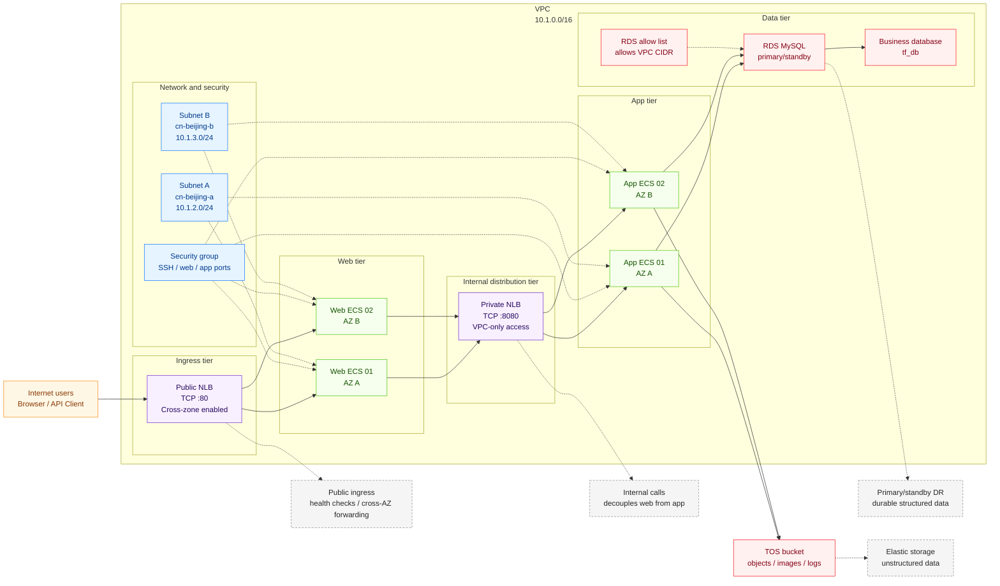

# Highly Available, Secure and Scalable Web Application Deployment

Deploy a highly available, scalable three-tier web application infrastructure on Volcengine, covering core resources such as networking, compute, load balancing, database and object storage. This solution adopts the classic three-tier architecture, deployed across multi-AZ subnets within a single VPC, and controls both east-west and north-south traffic through a unified security group.

## 1. Business Background

When enterprise web applications are deployed to production, they usually face the following problems:

- **Long deployment chain**: Resources such as VPC, subnets, security groups, ECS, load balancers, database and object storage need to be manually configured across multiple consoles, which makes it easy to miss steps.
- **Poor environment consistency**: If test, staging and production environments rely on manual provisioning, their parameters and topology are prone to drift, and subsequent troubleshooting becomes costly.
- **High availability requirements**: The public ingress point, application servers and database all need cross-AZ disaster recovery to avoid a single point of failure impacting business access.
- **Complex security boundary**: The access paths of the internet ingress, web tier, app tier and data tier differ, and need to be isolated through security groups, private load balancers and the RDS allow list.
- **High scaling and teardown cost**: Business peaks require rapid scale-out, and after validation resources must be reliably destroyed to reduce idle cost.

This solution standardizes and modularizes the above infrastructure through Terraform, helping users quickly deliver the foundation of a three-tier web application.

## 2. Solution Overview

The overall architecture follows the classic three-tier design:

- **Ingress tier**: The public NLB receives internet traffic and forwards it to the web tier ECS.
- **Web tier**: Multiple web ECS instances are deployed across AZs to handle frontend access requests.
- **Internal distribution tier**: The private NLB distributes requests from the web tier to the app tier inside the VPC.
- **App tier**: Multiple app ECS instances are deployed across AZs to handle core business logic.
- **Data tier**: RDS MySQL primary-standby instances carry structured data, and Torch Object Storage (TOS) buckets store unstructured data.
- **Security control**: A unified security group controls inbound access to ECS, and the RDS allow list allows the VPC CIDR by default.



## 3. IaC Design

### 3.1 Resource Inventory

When all modules are enabled in the current `terraform.tfvars`, 18 resources are created. The resource count varies with the number of subnets, ECS instances and feature switches:

| Terraform resource | Purpose |
| --- | --- |
| `volcenginecc_vpc_vpc` | Creates the business VPC and provides an isolated network space |
| `volcenginecc_vpc_subnet` × `length(subnet_cidrs)`, currently 2 | Creates cross-AZ subnets to carry ECS, NLB and RDS |
| `volcenginecc_vpc_security_group` | Creates a unified security group to control SSH, web and app port access |
| `volcenginecc_ecs_instance` (Web) × `web_instance_count`, currently 2 | Creates web tier ECS when the compute module is enabled, receiving traffic forwarded by the public NLB |
| `volcenginecc_ecs_instance` (App) × `app_instance_count`, currently 2 | Creates app tier ECS when the compute module is enabled, handling business logic and accessing the data tier |
| `volcenginecc_clb_nlb` (internet) | Creates the public NLB when both compute and load balancer modules are enabled |
| `volcenginecc_clb_nlb_server_group` (web) | Creates the web backend server group and binds web ECS |
| `volcenginecc_clb_nlb_listener` (internet) | Creates the public NLB listener, currently listening on TCP 80 |
| `volcenginecc_clb_nlb` (intranet) | Creates the private NLB when both compute and load balancer modules are enabled |
| `volcenginecc_clb_nlb_server_group` (app) | Creates the app backend server group and binds app ECS |
| `volcenginecc_clb_nlb_listener` (intranet) | Creates the private NLB listener, currently listening on TCP 8080 |
| `volcenginecc_rdsmysql_instance` | Creates a two-node RDS MySQL instance when the RDS module is enabled |
| `volcenginecc_rdsmysql_allow_list` | Creates an allow list when the RDS module is enabled, allowing the VPC CIDR by default |
| `volcenginecc_rdsmysql_database` | Creates a business database and grants read/write to the privileged account when the RDS module is enabled |
| `volcenginecc_tos_bucket` | Creates an object storage bucket for unstructured data when the TOS module is enabled |

Notes:

- The number of web and app ECS instances is controlled by `web_instance_count` and `app_instance_count`, defaulting to 2 each.
- The number of subnets is controlled by `availability_zones` and `subnet_cidrs`, defaulting to 2 AZs.
- The RDS allow list is created only when `allow_list_cidrs` is non-empty; the root module allows the current VPC CIDR by default.

### 3.2 Project Structure

The project is modular: the root module handles orchestration, and each submodule encapsulates specific resources:

```text
.
├── main.tf                         # Root module orchestration; invokes submodules in dependency order
├── variables.tf                    # Global variable definitions, including region, specs, switches and passwords
├── outputs.tf                      # Outputs key resource IDs, addresses and names
├── providers.tf                    # volcenginecc provider configuration
├── versions.tf                     # Terraform and provider version constraints
├── locals.tf                       # Local values such as common tags and the TOS bucket name
├── terraform.tfvars                # Default variable file
├── examples/                       # Scenario-based tfvars examples
│   ├── compute-only.tfvars.example
│   └── network-only.tfvars.example
└── modules/
    ├── network/                    # VPC, subnets and security group
    ├── compute/                    # Web and app ECS instances
    ├── load_balancer/              # Public and private NLBs, server groups and listeners
    ├── database/                   # RDS MySQL, databases and allow list
    └── storage/                    # TOS bucket
```

### 3.3 Core Code Examples

The root module controls whether each capability module is enabled through `enable_*` switches. The following is an excerpt of the key orchestration logic:

```hcl
module "network" {
  source             = "./modules/network"
  name_prefix        = var.name_prefix
  vpc_cidr           = var.vpc_cidr
  availability_zones = var.availability_zones
  subnet_cidrs       = var.subnet_cidrs
  # ...
}

module "compute" {
  source = "./modules/compute"
  count  = var.enable_compute ? 1 : 0

  vpc_id            = module.network.vpc_id
  subnet_ids        = module.network.subnet_ids
  subnet_zone_ids   = module.network.subnet_zone_ids
  security_group_id = module.network.security_group_id
  image_id          = var.image_id
  instance_type     = var.instance_type
  # ...
}

module "load_balancer" {
  source = "./modules/load_balancer"
  count  = var.enable_load_balancer && var.enable_compute ? 1 : 0

  vpc_id           = module.network.vpc_id
  subnet_ids       = module.network.subnet_ids
  web_instance_ids = module.compute[0].web_instance_ids
  app_instance_ids = module.compute[0].app_instance_ids
  # ...
}
```

The ECS module distributes instances evenly across AZs through `count.index % length(subnet_ids)`:

```hcl
resource "volcenginecc_ecs_instance" "web" {
  count         = var.web_instance_count
  instance_name = format("%s-web-%02d", var.name_prefix, count.index + 1)
  instance_type = var.instance_type
  zone_id       = var.subnet_zone_ids[count.index % length(var.subnet_ids)]

  primary_network_interface = {
    subnet_id          = var.subnet_ids[count.index % length(var.subnet_ids)]
    security_group_ids = [var.security_group_id]
  }
}
```

## 4. Usage

This project supports both one-click cloud deployment through InfraManager and local execution after downloading the template. Cloud deployment is recommended: no local Terraform runtime is needed, and resource creation and hosting are completed simply by filling in parameters on the platform.

### 4.1 Cloud Deployment

InfraManager is a managed Terraform workbench provided by Volcengine. For more product information, see [InfraManager Product Introduction](https://docs.volcengine.com/docs/infrastructure-management/product-introduction?lang=en).

#### 4.1.1 Prepare Permissions

The deployment identity must have create, read, update, delete and tag-management permissions for the following services:

- VPC, subnets and security groups
- ECS instances and system volumes
- NLB instances, server groups and listeners
- RDS MySQL instances, allow lists and databases
- TOS buckets

When using NLB for the first time, complete the service authorization prompted by the console. Before deployment, also confirm the account balance, service quotas, and ECS and RDS instance-type inventory in the target AZs. It is recommended to configure a least-privilege IAM role as the resource stack execution role, and do not fill in AK/SK in the template parameters.

#### 4.1.2 Select a Template

Open the [InfraManager Console](https://console.volcengine.com/iac), go to **Template Management > Public Templates**, and search for the published template name shown in the Chinese console: `高可用、安全可扩展的 Web 应用部署` (Highly Available, Secure and Scalable Web Application Deployment). Use the Chinese string as the search term.

#### 4.1.3 Create a Resource Stack

Select the template and click **Create Resource Stack**. Fill in the resource stack information and template parameters according to your actual needs. Create and review the execution plan; after confirming the changes match expectations, click **Execute Deployment**.

Key items to confirm before creation:

- Region, project, name prefix, AZs and subnet CIDRs
- ECS image, instance type, count, system volume and service ports
- Public and private NLB listener ports, cross-AZ and session-persistence settings
- RDS version, instance type, capacity, database name and additional allow list entries
- TOS bucket name and versioning status
- ECS and RDS passwords must be entered through the platform's sensitive-variable input and override the example defaults

#### 4.1.4 Deployment Verification

On the resource stack details page, confirm that the deployment status is "Succeeded", then review the template outputs:

| Output | Purpose |
| --- | --- |
| `vpc_id` | Locate the newly created VPC |
| `subnet_ids` | Locate all subnets |
| `security_group_id` | Locate the security group shared by ECS and NLB |
| `web_instance_ids` | Web ECS list; empty when the compute module is not enabled |
| `app_instance_ids` | App ECS list; empty when the compute module is not enabled |
| `web_instance_private_ips` | Web ECS private addresses, used for internal connectivity checks |
| `app_instance_private_ips` | App ECS private addresses, used for internal connectivity checks |
| `internet_nlb_id` | Public NLB ID; empty when not created |
| `intranet_nlb_id` | Private NLB ID; empty when not created |
| `internet_nlb_dns_name` | Public access endpoint; empty when not created |
| `intranet_nlb_dns_name` | In-VPC app access endpoint; empty when not created |
| `rds_instance_id` | RDS instance ID; empty when RDS is not enabled |
| `rds_database_name` | Business database name; empty when RDS is not enabled |
| `tos_bucket_name` | TOS bucket name; empty when TOS is not enabled |

The current outputs do not contain credentials such as passwords, but resource IDs and private addresses are still environment information; do not distribute them publicly.

With a full deployment using the current `terraform.tfvars`, the resource stack contains 18 Terraform-managed resources: 4 networking resources, 4 ECS instances, 6 NLB resources, 3 RDS resources and 1 TOS bucket. If modules are disabled or the number of instances and subnets is adjusted, the actual resource count changes accordingly.

### 4.2 Local Deployment

You can also download this project template and run it locally. Follow the steps below.

#### 4.2.1 Environment Preparation

Before executing this project, complete the following preparations:

1. Install Terraform `>= 1.5.0`.
2. Ensure access to the Terraform Registry; the provider version constraint is `~> 0.0.70`.
3. Enable the Volcengine VPC, ECS, CLB/NLB, RDS MySQL and TOS services.
4. Complete the first-time authorization in the NLB console and create the service-linked role `ServiceRoleForLoadBalancer`.
5. Prepare an ECS image ID available in the target region and AZs.
6. Confirm that ECS instance types, RDS instance types and inventory are available in the target AZs.
7. Prepare permissions for the execution account, including at least create, read, update and delete permissions for VPC, ECS, CLB/NLB, RDS and TOS.

It is recommended to inject access credentials through environment variables:

```bash
export VOLCENGINE_ACCESS_KEY="your_access_key"
export VOLCENGINE_SECRET_KEY="your_secret_key"
export VOLCENGINE_REGION="cn-beijing"
```

Do not write sensitive variables into `terraform.tfvars`; inject them through environment variables:

```bash
export TF_VAR_ecs_password="<placeholder>"
export TF_VAR_rds_super_account_password="<placeholder>"
```

The current example parameters are as follows. Parameters not explicitly set in `terraform.tfvars` use their variable defaults.

| Parameter | Current example value / default | Description |
| --- | --- | --- |
| `region` | `cn-beijing` | Deployment region |
| `project_name` | `default` | Project to which resources belong |
| `name_prefix` | `tf-clb` | Resource name prefix |
| `common_tags` | `Project`, `Environment`, `ManagedBy` | Injected into resources that support tags |
| `vpc_cidr` | `10.1.0.0/16` | VPC CIDR block |
| `availability_zones` | `cn-beijing-a`, `cn-beijing-b` | AZ list |
| `subnet_cidrs` | `10.1.2.0/24`, `10.1.3.0/24` | Subnet CIDR blocks; count must match AZs |
| `enable_compute` | `true` | Whether to create web and app ECS |
| `image_id` | Example public image ID | Must be replaced with an image available in the target region |
| `instance_type` | `ecs.g3i.large` | ECS instance type |
| `system_volume_type` | `ESSD_PL0` | ECS system volume type |
| `system_volume_size_gb` | `50` | ECS system volume size in GB |
| `ecs_password` | Sensitive; must be overridden | ECS login password |
| `web_instance_count` | `2` | Number of web ECS instances |
| `app_instance_count` | `2` | Number of app ECS instances |
| `web_server_port` | `80` | Web backend service port |
| `app_server_port` | `80` | App backend service port |
| `enable_load_balancer` | `true` | Whether to create NLB; also requires `enable_compute = true` |
| `internet_listener_port` | `80` | Public NLB listener port |
| `intranet_listener_port` | `8080` | Private NLB listener port |
| `nlb_cross_zone_enabled` | `true` | Whether to enable cross-AZ forwarding |
| `nlb_session_persistence_enabled` | `true` | Whether to enable source-IP session persistence |
| `enable_rds` | `true` | Whether to create RDS |
| `rds_db_engine_version` | `MySQL_5_7` | RDS MySQL version |
| `rds_node_spec` | `rds.mysql.1c2g` | RDS node instance type |
| `rds_storage_type` | `LocalSSD` | RDS storage type |
| `rds_storage_space_gb` | `100` | RDS storage capacity in GB |
| `rds_super_account_name` | `tf_super` | RDS privileged account name |
| `rds_super_account_password` | Sensitive; must be overridden | RDS privileged account password |
| `rds_database_name` | `tf_db` | Business database name |
| `rds_character_set` | `utf8mb4` | Database character set |
| `rds_allow_list_cidrs` | `[]` | Additional allow list entries; the VPC CIDR is added automatically |
| `enable_tos` | `true` | Whether to create a TOS bucket |
| `tos_bucket_name` | Empty | Bucket name; when empty, generated from the name prefix and plan date |
| `tos_enable_version_status` | `Enabled` | TOS versioning status |

#### 4.2.2 Scenario-Based Deployment Examples

Initialize and validate:

```bash
terraform init
terraform fmt -check -recursive
terraform validate
terraform plan
```

**Full deployment:**

Suitable for accounts that meet the permission, balance and service-enablement requirements. Creates networking, ECS, NLB, RDS and TOS; the current example creates 18 resources in total.

```bash
terraform plan -var-file=terraform.tfvars -out=tfplan
terraform apply tfplan
```

**Deploy only the network foundation:**

Suitable for first validating VPC, subnet and security-group permissions; the current example creates 4 resources in total.

```bash
terraform plan -var-file=examples/network-only.tfvars.example -out=tfplan
terraform apply tfplan
```

**Deploy networking and compute resources:**

Suitable for scenarios that do not yet create RDS and TOS, validating networking, ECS and NLB; the current example creates 14 resources in total.

```bash
terraform plan -var-file=examples/compute-only.tfvars.example -out=tfplan
terraform apply tfplan
```

Turning off a feature switch deletes the resources managed by that module on the next apply; it does not merely pause the service. When `enable_compute = false`, NLB is also not created. The ECS instance type, password, image, primary network interface and system volume configuration are ignored by lifecycle rules; modifying these parameters does not automatically update existing instances, so you should first evaluate replacement or manual-change options.

#### 4.2.3 Expected Deployment Result

After a full deployment using the current `terraform.tfvars`, the expected result is:

| Module | Expected resources |
| --- | --- |
| Network | 1 VPC, 2 subnets, 1 security group |
| Compute | 2 web ECS, 2 app ECS |
| Load balancing | 1 public NLB, 1 private NLB, 2 server groups, 2 listeners |
| Database | 1 two-node RDS MySQL instance, 1 allow list, 1 business database |
| Storage | 1 TOS bucket |

You can view Terraform outputs with:

```bash
terraform output
```

Common outputs include:

| Output | Description |
| --- | --- |
| `vpc_id` | VPC ID |
| `subnet_ids` | Subnet ID list |
| `security_group_id` | Security group ID |
| `web_instance_ids` | Web ECS ID list; empty when not enabled |
| `app_instance_ids` | App ECS ID list; empty when not enabled |
| `web_instance_private_ips` | Web ECS private address list |
| `app_instance_private_ips` | App ECS private address list |
| `internet_nlb_id` | Public NLB ID; empty when not enabled |
| `intranet_nlb_id` | Private NLB ID; empty when not enabled |
| `internet_nlb_dns_name` | Public NLB DNS name; empty when not enabled |
| `intranet_nlb_dns_name` | Private NLB DNS name; empty when not enabled |
| `rds_instance_id` | RDS instance ID; empty when not enabled |
| `rds_database_name` | Business database name; empty when not enabled |
| `tos_bucket_name` | TOS bucket name; empty when not enabled |

The following names are internal submodule outputs, used only for module orchestration or further customization; they are not directly exposed as root module outputs:

| Internal submodule output | Description |
| --- | --- |
| `vpc_cidr`, `subnet_zone_ids` | Network module VPC CIDR block and subnet AZs |
| `web_server_group_id`, `app_server_group_id` | NLB web and app server group IDs |
| `rds_engine_version`, `database_name`, `super_account_name` | RDS engine, database and account information |
| `bucket_id`, `bucket_name`, `intranet_endpoint`, `extranet_endpoint` | TOS bucket ID, name and access endpoints |

#### 4.2.4 Post-Deployment Quick Verification

The following steps verify the entire business path: public NLB → web ECS → private NLB → app ECS → RDS/TOS. Before executing, confirm that `enable_compute`, `enable_load_balancer`, `enable_rds` and `enable_tos` are all `true`, and that `terraform apply` has been completed.

1. **Check instance status**

   Inspect the enabled resources; ECS, NLB, RDS and the database should be available. Log in to the web ECS and app ECS, and run the following commands to temporarily start an HTTP service on the ECS:

   ```bash
   SERVICE_PORT=80
   sudo bash -c 'printf "hello from %s %s\n" "$(hostname)" "$(hostname -I)" > /root/index.html'
   sudo nohup python3 -m http.server "${SERVICE_PORT}" --directory /root \
     >/tmp/terraform-http-server.log 2>&1 &
   ```

   On each instance, run a local check; the expected response is `hello from <instance_name> <instance_ip>`:

   ```bash
   curl http://127.0.0.1:80/
   ```

2. **Check public NLB to web**

   After deploying the web service, confirm that the public NLB listener is bound to the web server group and that the backend is healthy, then access the public endpoint corresponding to `internet_nlb_dns_name`. Run the following commands on a local machine with internet access:

   ```bash
   PUBLIC_NLB_DNS="<public NLB DNS name from terraform output>"
   PUBLIC_NLB_PORT=80

   for i in $(seq 1 10); do
     curl -fsS -H 'Connection: close' \
       "http://${PUBLIC_NLB_DNS}:${PUBLIC_NLB_PORT}/"
   done
   ```

   The output should print the web ECS page 10 times. Consecutive identical content is normal because source-IP session persistence is enabled by default (`session_persistence_enabled = true`). To verify cross-AZ round-robin, temporarily disable session persistence.

3. **Check web to app**

   After deploying the app service, access `intranet_nlb_dns_name` and the private listener port from the web ECS. Run the following commands; the expected response is `hello from <instance_name> <instance_ip>`.

   ```bash
   PRIVATE_NLB_DNS="<private NLB DNS name from terraform output>"
   PRIVATE_NLB_PORT=8080

   for i in $(seq 1 10); do
     curl -fsS -H 'Connection: close' \
       "http://${PRIVATE_NLB_DNS}:${PRIVATE_NLB_PORT}/"
   done
   ```

4. **Check app to RDS**

   After confirming that the instance, business database and allow list are available, in the RDS MySQL console go to **Instance Details > Connection Management > Endpoint List** to obtain the private endpoint. On any app ECS, install the MySQL client and connect to the database, then use the private connection address to write a test row.

   ```bash
   sudo apt-get update
   sudo apt-get install -y mysql-client

   mysql \
     --host="<RDS private endpoint>" \
     --port=3306 \
     --user="<rds_super_account_name>" \
     --password \
     "<rds_database_name>"
   ```

   When prompted, enter the password corresponding to `TF_VAR_rds_super_account_password`; do not write the password directly into the command or commit it to a variable file. After connecting successfully, you can run the following test SQL. The insert should succeed and return 1 row:

   ```sql
   SELECT VERSION();
   CREATE TABLE IF NOT EXISTS terraform_verify (
     id INT PRIMARY KEY,
     note VARCHAR(64)
   );
   INSERT INTO terraform_verify (id, note)
   VALUES (1, 'hello-from-app-ecs')
   ON DUPLICATE KEY UPDATE note = VALUES(note);
   SELECT * FROM terraform_verify;
   DROP TABLE terraform_verify;
   ```

5. **Check app to TOS**

   The current template does not configure a TOS access identity for ECS. First prepare a least-privilege identity for the target bucket for the app, then upload, download and delete a non-sensitive test object from the app ECS.

#### 4.2.5 Destroy Resources

Before destroying, confirm that business data has been backed up and that objects in the TOS bucket have been cleared.

```bash
terraform plan -destroy
terraform destroy
```

Notes:

- NLB has delete protection enabled by default in the console; if destruction fails, disable delete protection in the console first.
- If the TOS bucket already contains objects, historical versions or delete markers, clear it before destroying.
- RDS allow list detachment may take effect asynchronously; if deletion reports an "in use" error, wait for the console state to stabilize before retrying.
- The ECS system volume is set to delete with the instance; back up business data before destroying.
- Destruction deletes all Terraform-managed resources; never run it unintentionally in production.

## 5. Summary

The main advantages of this solution:

- **Standardized delivery**: Provisions networking, compute, load balancing, database and storage resources consistently through Terraform.
- **High-availability design**: ECS, subnets, NLB and RDS adopt a cross-AZ deployment approach, reducing the impact of a single-AZ failure.
- **Modular reuse**: Modules are split into `network`, `compute`, `load_balancer`, `database` and `storage` for on-demand composition.
- **Clear boundaries**: The RDS allow list includes the VPC CIDR by default; ECS and RDS passwords are passed in through sensitive variables.
- **Scenario-based deployment**: The `enable_*` switches support full deployment, network validation, compute validation and degraded deployment for restricted accounts.

Future extensions:

- Add middleware modules such as Redis and message queues to support more complex application architectures.
- Integrate CDN, WAF, TLS certificates and DNS resolution to complete the public access path.
- Add logging, monitoring, alerting and auto-scaling to improve operational observability.
- Integrate a remote backend to manage Terraform state, supporting team collaboration and CI/CD pipelines.
